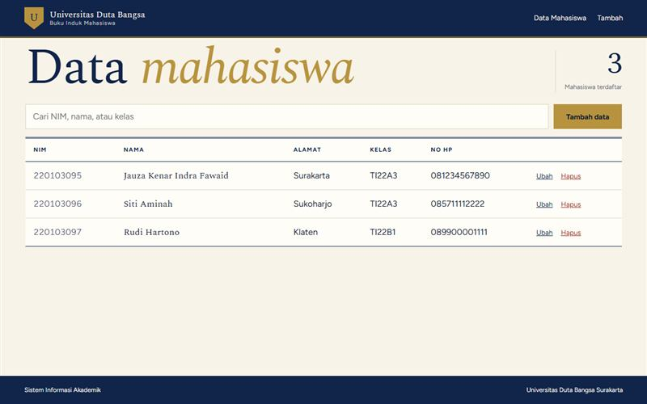

# Buku Induk Mahasiswa

CRUD data mahasiswa dengan Laravel 8.

**Demo:** https://portofolio-jauza-fawaid.netlify.app/DATA-MAHASISWA-KAMPUS/mahasiswa.html (pratinjau statis dengan data contoh)



## Fitur

- Tambah, ubah, dan hapus data mahasiswa
- Pencarian langsung di tabel
- 4 uji otomatis untuk alur CRUD

## Menjalankan

```bash
composer install
cp .env.example .env
php artisan key:generate
php artisan migrate
php artisan serve
```

## Pengujian

```bash
php artisan test
```

## Teknologi

Laravel 8, Blade, MySQL
